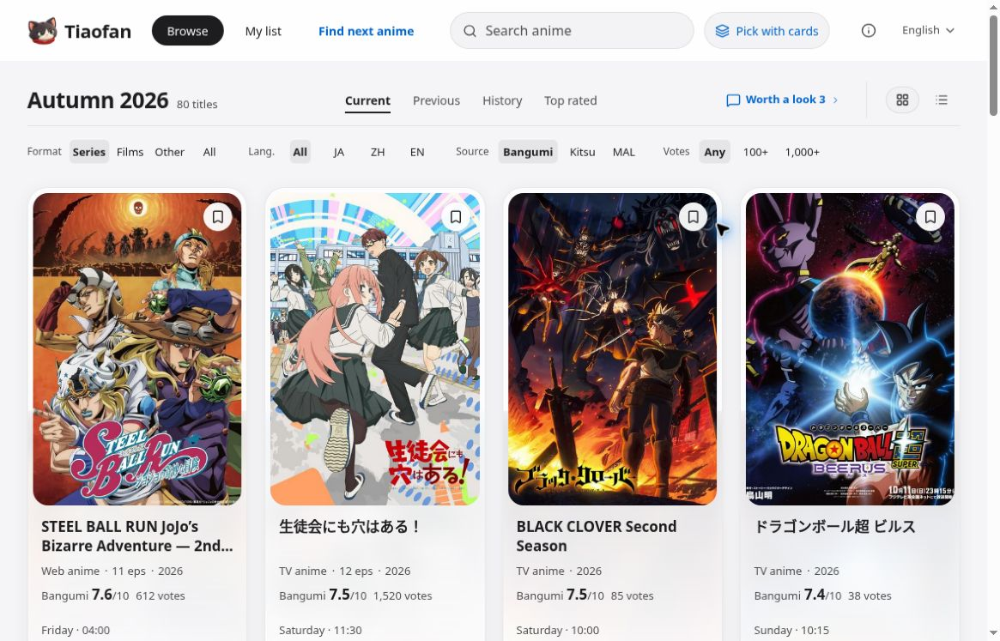
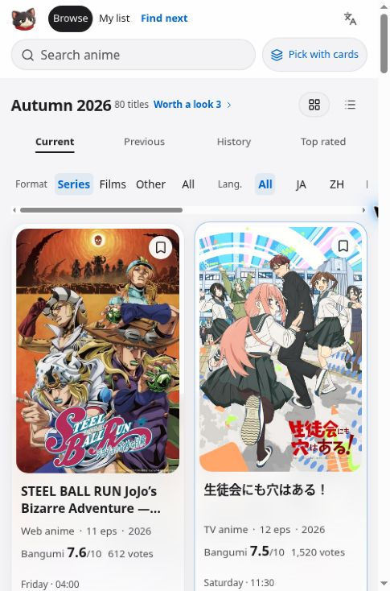

# Tiaofan · 挑番

**Find your next anime, understand the sources, and keep your watchlist close.**

A multilingual anime discovery experience in English, Chinese and Japanese, with seasonal browsing, source-aware title details and a responsive reading interface.

[Live website](https://anime.hubeiqiao.com/en) · [中文说明](README.zh-CN.md) · [Quick start](#quick-start) · [Documentation](#documentation)

## Built with GPT Sites

**The entire website was built with GPT Sites through iterative prompting, implementation, and testing.** Product design, interface development and successive refinements were developed in that workflow. This was an iterative build, not a claim that a complete production product appeared from a single prompt.

This repository makes a sanitized source edition available for review. Reuse and further development remain subject to the owner's eventual code-license selection. It is an independently created project, not an official OpenAI product or endorsement. [How it was built →](docs/BUILT_WITH_GPT_SITES.md)

## Preview

### Desktop catalog



### Narrow-browser responsive catalog



Captured from the [hosted product](https://anime.hubeiqiao.com/en) on October 14, 2026. These are genuine, unedited browser captures, not renders of the synthetic source demo. The narrow view demonstrates responsive browser rendering; it is not a physical-device test. Third-party artwork and data visible in the screenshots retain their own rights. [Screenshot provenance and rights →](docs/screenshots/README.md)

## Explore the product

- **Seasonal discovery:** browse current and previous seasons, filter titles and switch between compact and visual catalog layouts.
- **Three languages:** English, Chinese and Japanese interfaces, with language-specific routes and metadata.
- **Source-aware details:** distinguish ratings, dates, synopsis material and viewing evidence rather than presenting missing data as verified facts.
- **Reading on any screen:** responsive layouts, light/dark appearance and accessibility fallbacks.
- **Watchlist interactions:** viewing state, favorites and recommendation flows in the hosted product; reusable interface and domain logic in the source edition.
- **AI-readable structure:** public API and MCP code for structured catalog access.

## What is in this repository?

The source edition includes the interface, domain logic, schemas, adapters and regression tests. It runs with **six clearly marked fictional titles and neutral local SVG artwork**. Ratings, reviews and playback evidence are empty in the demo.

Production datasets, private watchlists, personal images, credentials and runtime configuration are not included. The hosted product's authentication and connector services are platform capabilities; the standalone demo deliberately disables sign-in, private persistence and AI calls until an operator supplies a reviewed integration.

See [data and asset boundaries](docs/DATA_SOURCES.md) and the [deployment guide](docs/DEPLOYMENT.md) before connecting real services.

## Quick start

Use Node.js 24 and npm. Local validation used Node.js 24.19.0; the manifest minimum is 22.13, but older versions were not separately tested.

```sh
git clone https://github.com/hubeiqiao/tiaofan.git
cd tiaofan
npm ci
npm run dev
```

Open the local address printed by the server, normally http://127.0.0.1:5173. The demo needs no production API key, Cloudflare account or original-site login.

```sh
npm run typecheck
npm test
npm run build
npm start
```

To check a running development server:

```sh
npm run test:smoke -- http://127.0.0.1:5173
```

The default canonical origin is example.invalid. Set your own origin in lib/site-brand.ts before deployment. Environment and production-integration guidance is in [docs/DEPLOYMENT.md](docs/DEPLOYMENT.md).

## Architecture

- **Interface:** React, TypeScript, responsive CSS and reusable UI components
- **Application runtime:** Vinext, Vite and Cloudflare Workers tooling
- **Domain layer:** catalog normalization, source evidence, relationships, navigation and viewing-state logic
- **Data layer:** synthetic local snapshots by default, with source adapters retained as implementation references
- **Private features:** isolated behind a disabled-by-default identity boundary; database schema and migration source are available for integration work

```text
app/           Pages and HTTP/MCP routes
components/    Reusable product and UI components
hooks/         Client interaction state
lib/           Domain logic and source adapters
data/          Synthetic fixtures and UI translations
scripts/       Preparation, safety and verification tooling
tests/         Regression tests
docs/          Setup, provenance and release review
```

## Validation and project status

Local validation passed **123 automated tests**, type checking, production build/CSS checks and 14 HTTP checks each against development and built local servers. These are recorded local results, not an assertion that GitHub CI has passed.

The project retains a disclosed lint backlog and two development-tool advisory roots. CI applies a narrow full-dependency advisory policy rather than silently ignoring new high/critical findings. Details and machine-readable results are in the [release review](docs/RELEASE_REVIEW.md).

**Code license selection is pending.** Public visibility does not itself grant a general open-source license. Third-party code, data, artwork and trademarks retain their own terms. See [LICENSE-STATUS.md](LICENSE-STATUS.md) and [THIRD_PARTY_NOTICES.md](THIRD_PARTY_NOTICES.md).

## Documentation

- [Built with GPT Sites](docs/BUILT_WITH_GPT_SITES.md)
- [Development and deployment](docs/DEPLOYMENT.md)
- [Data sources and content rights](docs/DATA_SOURCES.md)
- [Release review and validation limits](docs/RELEASE_REVIEW.md)
- [Dependency remediation](docs/DEPENDENCY_REVIEW.md)
- [Repository setup](docs/REPOSITORY_SETUP.md)
- [Security policy](SECURITY.md)
- [Contributing](CONTRIBUTING.md)

Created by [hubeiqiao](https://github.com/hubeiqiao).
